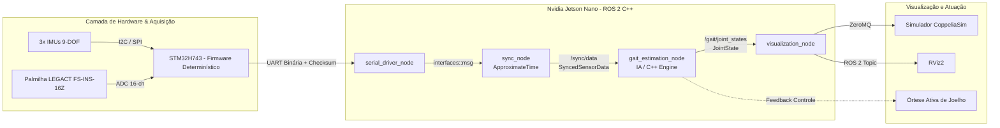

# Plano Diretor de Migração e Desenvolvimento (IC & TCC 1 - 6 Meses)

**Projeto:** Estimação da Marcha Antropomórfica usando Sensores de Pressão Plantar e IMUs em Arquitetura ROS 2 com STM32 e Nvidia Jetson Nano  
**Aluno/Bolsista:** Lucas da Conceição Damasceno  
**Orientador:** Prof. Dr. Armando Sanca Sanca  
**Período:** Setembro/2026 – Fevereiro/2027 (6 Meses / Conclusão de TCC 1 e IC)

---

## 1. Visão Geral e Arquitetura do Sistema

O objetivo central é a reestruturação da arquitetura de software embarcada em **ROS 2 utilizando C++ (`rclcpp`)**, substituindo a antiga stack em Raspberry Pi 4 pela **Nvidia Jetson Nano integrada a um microcontrolador STM32H743**. O foco é atingir inferência determinística com latência $< 10\text{ ms}$ e taxa de amostragem de até $1\text{ kHz}$ para estimação de fases da marcha (*heel-strike*, *toe-off*) e ângulos articulares (quadril, joelho, tornozelo).

---

## 2. Cronograma de Execução (6 Meses)

| Mês | Período | Meta Principal | Entregáveis Técnicos |
| :---: | :---: | :--- | :--- |
| **Mês 1** | **09/2026** | **Reestruturação do Workspace & Interfaces C++** | • Limpeza de arquivos espúrios do workspace. • Migração e compilação dos pacotes C++ (`interfaces`, `common_serial`, `nodes`, `launch`). • Criação do esqueleto do pacote `gait_estimation_pkg` em C++ com CMake configurado. |
| **Mês 2** | **10/2026** | **Driver Serial STM32 & Sincronização Temporal** | • Implementação do protocolo serial binário com verificação de Checksum (CRC). • Publicação de mensagens customizadas (`IMUState`, `PressureState`). • Validação do `sync_node` em alta frequência ($1\text{ kHz}$) gerando `/sync/data`. |
| **Mês 3** | **11/2026** | **Visualização e Integração CoppeliaSim (C++)** | • Implementação do `visualization_node` em C++ (`rclcpp`). • Envio de dados via ZeroMQ C++ / Remote API para o modelo 3D no CoppeliaSim. • Publicação de `sensor_msgs/msg/JointState` para RViz2. |
| **Mês 4** | **12/2026** | **Módulo de Inferência em C++ (`gait_estimation_node`)** | • Integração de modelos de Inteligência Computacional (SVM/Random Forest/MLP exportados para C++ via ONNX Runtime / LibTorch). • Classificação de eventos de marcha (*heel-strike*, *toe-off*) e predição angular com latência $< 10\text{ ms}$. |
| **Mês 5** | **01/2027** | **Calibração e Validação Experimental** | • Calibração estática/dinâmica dos sensores (IMUs e palmilhas de pressão). • Testes de bancada e validação comparativa com dados de referência (*ground truth* / OptiTrack). • Cálculo de métricas: RMSE, correlação de Pearson e latência temporal. |
| **Mês 6** | **02/2027** | **Consolidação, Monografia TCC 1 e Relatório IC** | • Redação final da Monografia de TCC 1. • Redação do Relatório Técnico da IC / Resumo SEMIC. • Documentação e disponibilização de código aberto no GitHub. |

---

## 3. Estado de Execução das Tarefas

- [x] **Mês 1 - Preparação e Estruturação Base**
  - [x] Limpar diretório `ros2_ws/src/gait_monitoring_pkg` e artefatos de compilação indevidos.
  - [x] Consolidar pacotes base em `/ros2_ws/src`: `interfaces`, `common_serial`, `nodes`, `bringup`.
  - [x] Criar pacote C++ `gait_estimation_pkg` contendo o esqueleto do `gait_estimation_node` e `visualization_node`.
  - [x] Compilar e validar o workspace limpo via `colcon build`.
- [x] **Mês 2 - Comunicação Serial & Sincronização**
  - [x] Implementar protocolo de frame binário com Start of Frame (`0xAA 0x55`), CRC16 e suporte a 2 palmilhas (16 canais cada) e até 3 IMUs (`stm32_protocol.hpp`).
  - [x] Implementar `serial_driver_node` em C++ com suporte a múltiplas portas USB (`/dev/ttyACM0` e `/dev/ttyACM1`) e fallback ASCII.
  - [x] Implementar emulador `stm32_emulator_node` para testes de bancada e simulação offline.
  - [x] Criar arquivo de launch consolidado da Jetson (`jetson_bringup.launch.py`) integrando aquisição, sincronização e estimação.
  - [x] Sincronização temporal de alta taxa orientada à palmilha (`use_fast_insole_sync = true` a ~1 kHz) com Zero-Order Hold das IMUs (~100 Hz).
  - [x] Correção de multiplexação física binária dos pinos de seleção de endereço das IMUs (`00`, `01`, `10`, `11`).
- [x] **Mês 3 - Visualização e CoppeliaSim**
  - [x] Implementar `visualization_node` em C++ (`rclcpp`) com ZeroMQ Publisher em tempo real.
  - [x] Publicar `sensor_msgs/msg/JointState` no tópico `/joint_states` para RViz2.
  - [x] Criar script/ponte cliente ZeroMQ (`coppeliasim_subscriber.py`) para renderizar a silhueta humana e a órtese no CoppeliaSim.
  - [x] Desenvolver interface 3D completa no RViz2 (`sensor_visualizer_node`): mapa de calor plantar Jet, CoP dinâmico, eixos 3D de atitude e HUD de monitoramento de frequência em Hz e $\Delta t$.
  - [x] Eliminação e saneamento completo do código legado (`system/`, `wiringpi`, backups), tornando a base 100% C++ nativa e autocontida.
- [x] **Mês 4 - Motor de Inferência C++**
  - [x] Implementar extrator de características biomecânicas em tempo real (`gait_features.hpp`): razões de carga Heel/Midfoot/Forefoot, CoP longitudinal e velocidades angulares.
  - [x] Implementar classificadores de fases de marcha em C++ (`SVMGaitClassifier` e `RandomForestGaitClassifier`): *Heel Strike*, *Mid Stance*, *Toe Off*, *Swing*.
  - [x] Implementar estimador cinemático de juntas (`MLPKinematicEstimator`) para predição angular (Quadril, Joelho, Tornozelo).
  - [x] Integrar medição de latência em microssegundos publicando em `/gait/latency_ms` (garantindo requisito $< 10\text{ ms}$).
- [ ] **Mês 5 - Validação Experimental**
  - [ ] Ensaios e cálculo de métricas de acurácia.
- [ ] **Mês 6 - Finalização de Documentos**
  - [ ] Entrega da monografia e relatório.

